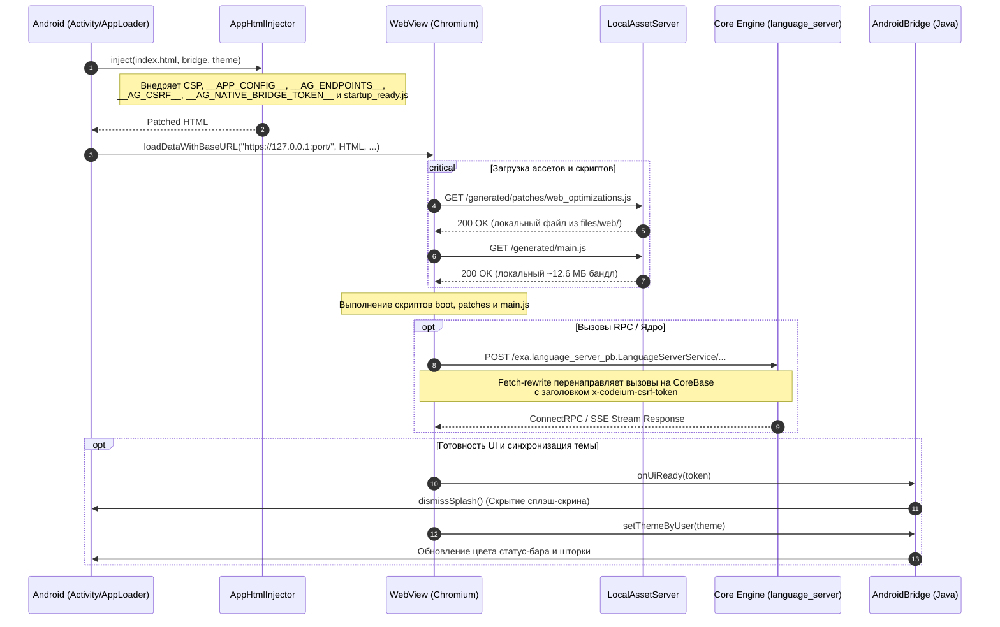

# Веб-интерфейс Antigravity: `web/`

> Одностраничное приложение (SPA на базе React), выполняемое в изолированном Android WebView и взаимодействующее с локальным Go/C++ ядром (`language_server`) через loopback HTTPS и нативный Java-мост (`AndroidBridge`).

---

## 1. Архитектурный обзор (Architecture Overview)

Веб-слой Antigravity представляет собой специализированный UI-фронтенд, упакованный в ассеты приложения и оптимизированный для работы на сенсорных экранах Android (ARM64). Вместо загрузки через классическую схему `file:///android_asset/` (блокирующую современные возможности браузера и работу ConnectRPC), интерфейс монтируется в `WebView` через `loadDataWithBaseURL` на доверенный origin loopback-сервера `https://127.0.0.1:<port>/`.

### Архитектурная диаграмма взаимодействий



---

## 2. Структура файлов и каталогов

```
web/
├── build.sh                      # Баш-оркестратор сборщика фрагментов и патчера
├── src.manifest                  # Декларативный манифест сборки web/generated/**
├── patch_main.py                 # Патчер upstream main.js (инъекция Desktop Mode в Appearance)
├── index.html                    # Корневой HTML-шаблон хоста приложения
├── main.js                       # Исходный (upstream) обфусцированный бандл React UI (~12.6 МБ)
├── jetbox.css                    # Стили специфичных контролов и терминала
├── compiled_tailwind.css         # Базовый скомпилированный бандл Tailwind CSS
├── prism_bundle.js               # Бандл подсветки синтаксиса PrismJS (defer)
├── page_agent_bundle.js          # Скрипт-генератор in-page DOM/ARIA рантайма (__agyBuildPageAgentScript)
├── page_facade_bundle.js         # Playwright-совместимый фасад автоматизации (__agyBuildPageFacade)
├── diff_worker.js                # Web Worker для фонового вычисления диффов (diffArrays и diffStats)
├── audio_processor.js            # AudioWorkletProcessor для ресемплинга микрофона в 16 kHz PCM
├── antigravity-icon.png          # Растровый логотип/иконка приложения
├── dark.png / light.png          # Растровые ассеты тем
├── google_signin.svg             # Векторный ассет кнопки входа
├── symbols-icons/                # Локальный кэш иконок Material Symbols
├── prism/                        # Вендорные грамматики PrismJS
├── voices/                       # Аудио-ассеты голосовых режимов
├── workers/                      # Воркеры PDF.js и Shiki v4 (см. ./workers/README.md)
│   ├── pdf.min.mjs               # Библиотека PDF.js core (v5.3.93)
│   ├── pdf.worker.mjs            # Воркер парсинга PDF (v5.3.93)
│   ├── pdfjs_loader.mjs          # Мост между Closure compiler и ESM PDF.js
│   └── shiki_worker.js           # Closure-скомпилированный Shiki v4 воркер (42 языка)
├── generated/                    # Каталог артефактов сборки (пересоздаётся build.sh)
│   ├── main.js                   # Пропатченный рабочий бандл приложения
│   ├── bridge.core.js            # Ядро моста, полифиллы, рерайтер fetch и stream recovery
│   ├── boot/                     # Скрипты ранней инициализации (<head>)
│   │   ├── custom-elements-guard.js
│   │   └── theme-bootstrap.js
│   └── patches/                  # Мобильные патчи и адаптеры
│       ├── web_optimizations.js
│       ├── touch_model_menu.js
│       ├── theme_sync.js
│       ├── mobile_bridge.js
│       └── startup_ready.js
├── src/                          # Модульные исходники фрагментов бандлов (см. ./src/README.md)
│   ├── boot/                     # Фрагменты раннего старта
│   ├── core/                     # Фрагменты ядра моста (namespace, csrf, fetch, recovery, ...)
│   └── patches/                  # Фрагменты функциональных патчей
└── tests/
    ├── selftest.sh               # Тест сборки и проверки целостности исходников
    └── test_web_patches.mjs      # Модульные Node-тесты патчей, ядра и моста
```

---

## 3. Конвейер сборки бандлов (Bundling Pipeline)

Сборка веб-слоя выполняется утилитой [`build.sh`](build.sh) на основе манифеста [`src.manifest`](src.manifest). Пайплайн спроектирован так, чтобы гарантировать **неизменность апстримного файла `main.js`**: все изменения вносятся исключительно в копию в `web/generated/main.js`.

### Синтаксис `src.manifest`
- `bundle iife <path>` — объявляет бандл с оборачиванием в изолированную IIFE `(function(){ ... })();`. Если исходные фрагменты бандла уже имеют собственное замыкание верхнего уровня, `build.sh` автоматически пропускает повторную обертку, предотвращая появление вложенных `(function(){(function(){...})()})();`.
- `bundle <path>` — объявляет бандл с прямой конкатенацией без замыкания.
- `src/<path>` — добавляет фрагмент кода в текущий открытый бандл.
- Строки `#` и `;` считаются комментариями.

### Генерируемые бандлы

| Бандл (`web/generated/...`) | Режим | Размер | Назначение |
|---|---|---|---|
| **`boot/custom-elements-guard.js`** | IIFE | ~514 B | Предотвращает краш при повторной регистрации Custom Elements в overlay-бандлах. |
| **`boot/theme-bootstrap.js`** | IIFE | ~1.3 KB | Мгновенно применяет `light`/`dark` до первого рендера, предотвращая мигание экрана. |
| **`bridge.core.js`** | IIFE | ~26.0 KB | Полифиллы (`onLine`, `Notification` -> `Android.showAgentNotification`, `window.process`), конфигурация, CSRF, discovery эндпоинтов, рерайтер `fetch` и восстановление потоков при резюме хоста. |
| **`patches/web_optimizations.js`** | IIFE | ~19.4 KB | Отключение 300мс задержки тапа, фиксация `--agy-vvh` и IME-деферрал `resize`/`ResizeObserver`, focus guard, safe-area и BiDi CSS. |
| **`patches/touch_model_menu.js`** | IIFE | ~10.7 KB | Адаптация hover-меню выбора моделей Base UI под сенсорный ввод. |
| **`patches/theme_sync.js`** | IIFE | ~8.2 KB | MutationObserver за классами `<html>`/`<body>`, `<meta name="color-scheme">` и передача смены темы и цвета поверхности в нативный Android. |
| **`patches/mobile_bridge.js`** | IIFE | ~78.8 KB | Мост Share Sheet, Extra-Keys Bar, `VoiceForegroundService`/диктовки/шим `navigator.permissions.query({name:'microphone'})`, вставки изображений из буфера и панели Android Tools в Settings/Drawer. |
| **`patches/startup_ready.js`** | IIFE | ~5.0 KB | Детектор первого полезного рендера DOM (`#root`) / `[ConversationLoad]` и перехватчик JS-ошибок для `AndroidBridge`. |
| **`main.js`** | Raw + Patch | ~12.6 MB | Рабочий бандл React UI, скопированный из `web/main.js` и пропатченный скриптом `patch_main.py`. |

### Проверка валидности (Verification)
После сборки `build.sh` запускает статический синтаксический анализатор V8 (`node --check`) для каждого сгенерированного файла. Если Node.js не установлен в окружении, проверка пропускается с информационным предупреждением.

---

## 4. Патчинг основного бандла (`patch_main.py`)

Скрипт [`patch_main.py`](patch_main.py) выполняет динамическую модификацию скопированного и обфусцированного бандла `web/generated/main.js`:

1. **Идемпотентность**: Перед патчингом проверяется наличие маркеров `"Desktop Mode"` или `"ag_desktop_mode"`. Если они присутствуют, повторное применение пропускается (`return True`).
2. **Внедрение Desktop Mode Toggle**:
   - Предпочитает якорь перед `;return <react_id>.createElement(...{title:"Appearance"})` и использует legacy-сигнатуру хуков (`!==3` / `!==2`) лишь как резервный якорь.
   - Динамически определяет имена компонентов элемента настройки и переключателя рядом с `rightElement:` через `_detect_setting_components` и проверяет их объявление в бандле через `_identifier_declared` (без захардкоженных запасных имён).
   - Внедряет React-хуки `useState` и `useCallback`, связывающие состояние с `window.Android.isDesktopMode()`, `window.Android.setDesktopMode(v)` и `localStorage['ag_desktop_mode']`, и вставляет переключатель сразу после секции `{label:"Theme"}`.
3. **Валидация и безопасная деградация**:
   - Записывает результат во временный файл рядом с целью, проверяет синтаксис через `node --check` (`_verify_js_syntax`, таймаут 30с) и выполняет атомарный `os.replace`.
   - Если якорь, `react_id`, компоненты или синтаксис не проходят проверку, выводит предупреждение в `stderr`, оставляет целевой файл нетронутым и возвращает `True` (переключатель остаётся доступен в `mobile_bridge.js`).

---

## 5. Взаимодействие с нативным Android (`AndroidBridge`)

Веб-приложение выполняется в WebView, где объект `Android` (а также псевдоним `window.AndroidBridge`) зарегистрирован через `addJavascriptInterface`.

### Инъекции во время загрузки (`AppHtmlInjector`)
Перед передачей разметки в движок WebView, Java-класс `AppHtmlInjector` внедряет в `<head>`:
- **Strict Content Security Policy (CSP)**: запрет небезопасных внешних фреймов и объектов, ограничение `worker-src 'self' blob:`.
- **Глобальные параметры конфигурации**:
  - `window.__APP_CONFIG__` — JSON-параметры среды (версия, платформа, пути к воркспейсу).
  - `window.__AG_ENDPOINTS__` — адрес core-сервера (`core`, `core_http`, `enginePort`).
  - `window.__AG_CSRF__` — криптографический CSRF-токен для авторизации в `language_server`.
  - `window.__AG_HOST_THEME__` / `window.__AG_RESOLVED_THEME__` — начальная тема хоста (`dark` / `light` / `system`).
  - `window.__AG_NATIVE_BRIDGE_TOKEN__` — криптографический 32-байтный одноразовый токен для авторизации привилегированных вызовов (сброс сплэша, сохранение блобов).
- **Скрипт сигнала готовности**: `<script src="./generated/patches/startup_ready.js"></script>`.

### Интерфейсы моста `window.Android`

Все 27 `@JavascriptInterface` методов в `AndroidBridge`:

| Метод | Сигнатура | Назначение |
|---|---|---|
| `onUiReady` | `(token: string) => void` | Скрывает нативный сплэш-экран по сигналу готовности DOM (`startup_ready.js`) и доставляет отложенные share/notification payload'ы. |
| `openDirectoryPicker` | `() => void` | Запускает системный диалог выбора папки (SAF Document Tree) для открытия проекта. |
| `onUiError` | `(token: string, errorMessage: string) => void` | Передает критические фатальные ошибки JS в нативный логкат и экран ошибки. |
| `setTheme` | `(mode: string) => boolean` | Применяет программную тему хоста (`"dark"`/`"light"`/`"system"`). |
| `setThemeByUser` | `(mode: string) => boolean` | Передает выбранную пользователем тему для сохранения и обновления системных баров Android. |
| `onVisualThemeChanged` | `(visual: string) => void` | Сигнализирует о смене активного CSS-оформления. |
| `getTheme` | `() => string` | Возвращает текущую системную тему устройства. |
| `setSurfaceColor` | `(token: string, hexColor: string) => boolean` | Синхронизирует цвет статус-/нав-бара Android с живым фоном WebView. |
| `isDesktopMode` | `() => boolean` | Проверяет, включен ли режим широкого десктопного Viewport. |
| `setDesktopMode` | `(enabled: boolean) => void` | Переключает User-Agent и Viewport WebView между мобильным и десктопным режимами. |
| `isExtraKeysVisible` | `() => boolean` | Возвращает состояние видимости нативной панели быстрых клавиш (`ExtraKeysBarView`). |
| `setExtraKeysVisible` | `(visible: boolean) => void` | Показывает или скрывает панель быстрых клавиш над клавиатурой. |
| `openLocalPreview` | `(token: string, url: string) => boolean` | Открывает изолированный `LocalPreviewDialog` для локального loopback URL (`127.0.0.1`/`localhost`). |
| `openRemotePortal` | `(token: string) => boolean` | Открывает Remote PC Control портал (`https://antigravity.google.com`) во внешнем Custom Tab. |
| `startVoiceDictation` | `(token: string) => boolean` | Запускает нативный Android `SpeechRecognizer` для диктовки текста. |
| `stopVoiceDictation` | `(token: string) => boolean` | Останавливает активную нативную голосовую диктовку. |
| `isVoiceDictating` | `() => boolean` | Проверяет, активен ли в данный момент `SpeechRecognizer`. |
| `startVoiceService` | `(token: string) => boolean` | Запускает `VoiceForegroundService` (foreground notification, AudioFocus, Bluetooth SCO/BLE). |
| `stopVoiceService` | `(token: string) => boolean` | Останавливает активный `VoiceForegroundService`. |
| `setVoiceMuted` | `(token: string, muted: boolean) => boolean` | Синхронизирует состояние mute микрофона между WebView и уведомлением `VoiceForegroundService`. |
| `isVoiceServiceActive` | `() => boolean` | Возвращает активность `VoiceForegroundService`. |
| `isVoiceMuted` | `() => boolean` | Возвращает текущее состояние mute голосового сервиса. |
| `getMicrophonePermissionState` | `() => string` | Возвращает хостовый статус `RECORD_AUDIO` (`"granted"` или `"prompt"`) для согласования pre-check в WebView. |
| `showAgentNotification` | `(token: string, title: string, body: string, tag: string, silent: boolean) => boolean` | Публикует нативное уведомление агента в статус-бар из полифилла `Notification`. |
| `hasClipboardImage` | `() => boolean` | Проверяет наличие изображения в системном буфере обмена Android. |
| `readClipboardImage` | `(token: string) => string` | Читает изображение из буфера обмена как JSON/Base64 payload для вставки в чат. |
| `saveBlob` | `(token: string, base64Data: string, filename: string, mimeType: string) => void` | Безопасное сохранение сгенерированных веб-интерфейсом блобов в хранилище `Downloads`. |

---

## 6. Подсистемы веб-слоя

### 6.1. Подсистема тем (Theme Engine)
1. **Ранняя стадия (`theme-bootstrap.js`)**: Выполняется синхронно в `<head>`. Читает `?hostTheme=` или `__AG_HOST_THEME__`. Моментально ставит класс `dark`/`light` на `document.documentElement` и задает `style.colorScheme`. Исключает белый блик при запуске в тёмной теме.
2. **Синхронизация во время работы (`theme_sync.js`)**: 
   - `MutationObserver` слушает изменения атрибута `class` на `<html>` и `<body>`.
   - Слушатель `window.addEventListener('storage')` отслеживает смену темы во вкладках.
   - Слушатель `matchMedia('(prefers-color-scheme: dark)')` реагирует на системное расписание день/ночь.
   - Метод `notify()` обновляет нативные шторки и панели Android.

### 6.2. Мобильные оптимизации (Mobile & Touch Optimizations)
- **`web_optimizations.js`**:
  - `touch-action: manipulation` на кнопках, ссылках и инпутах отключает браузерную 300-миллисекундную задержку двойного тапа.
  - Безопасные отступы `--agy-safe-top` / `--agy-safe-bottom` / `--agy-safe-left` / `--agy-safe-right` объединяют нативные `env(safe-area-inset-*)` и предзагруженные хостом `--agy-inset-*` (с обнулением нижнего отступа через класс `html.agy-extra-keys` при видимой панели быстрых клавиш) для шапки, поля ввода, `bottom-sheet`, `.agy-shell`, настроек и онбординга.
  - `__agSetImeAnimating(true/false)` и дедупликация `--agy-vvh` в `viewport.js` (через `requestAnimationFrame`) приостанавливают каскад `window.resize` / `visualViewport.resize` и `ResizeObserver` во время анимации клавиатуры IME с однократным сбросом в `onEnd` (и 450мс страховкой), устраняя дерганье кадра.
  - Скрытие десктопного `overlay-scrollbar` и блокировка дорогостоящих `backdrop-filter` / `mask-image` для плавного скролла на мобильных GPU.
- **`touch_model_menu.js`**:
  - Выпадающий список выбора моделей Antigravity в библиотеке Base UI открывает меню уровней размышления (Low / Medium / High) исключительно по hover-событию мыши.
  - На сенсорном экране тап приводил к мгновенному выбору модели по умолчанию без раскрытия настроек.
  - Патч перехватывает `pointerdown`/`mousedown`/`click` в capture-фазе, блокирует событие, переводит фокус и симулирует синтетическую цепочку событий указателя (`pointerover`, `pointerenter`, `pointermove`, `mouseover`, `mouseenter`, `mousemove`), после чего отслеживает готовность строки через `focus` и `MutationObserver` (`isRowReadyForKey`) и посылает `KeyboardEvent('ArrowRight')` с резервными таймаутами `70мс`, `260мс` и лимитом ожидания `600мс`.
- **`mobile_bridge.js`**:
  - Реализует мост `window.__agMobileBridge` и глобальные колбэки `window.__ag*`: приём данных из Android Share Sheet с резервным баннером вставки, deep-link переходы в диалог через `__agOpenConversation` (`/c/$cascadeId`), отправку клавиш/ANSI из Extra-Keys Bar в xterm и редактор, интеграцию `VoiceForegroundService`/`SpeechRecognizer` (хуки `/voice/ws`, живой индикатор уровня микрофона и диагностику ошибок `getUserMedia`/`WebSocket`), вставку изображений из нативного буфера обмена и секцию **Android Tools** в Settings/Drawer.

### 6.3. Мост ядра и транспорт (Core Transport & Fetch Rewrite)
- **`bridge.core.js`**:
  - Создает стаб `window.process` (Linux / ARM64 / renderer) со стандартными методами `cwd()` и `nextTick()`, патчит `Navigator.prototype.onLine` (всегда `true`) и устанавливает полифилл `Notification` при его отсутствии.
  - Переопределяет `window.fetch`. Относительные/`file://` запросы к ConnectRPC-маркерам (`exa.language_server_pb.`, `exa.host_bridge_pb.`, `/exa.`, `/jetski.`) переписываются на целевой origin ядра `https://127.0.0.1:<enginePort>` с автоматической инъекцией заголовка `x-codeium-csrf-token` и параметра `csrf_token`.
  - Выполняет безопасные ретраи старта (`fetchWithStartupRetry`: до 30 попыток с шагом 120мс только для `GET`/`HEAD`/`OPTIONS`, потоков и `Get|List|Check|Heartbeat|Stream|Subscribe*`; мутирующие `POST` получают 0 повторов) и ретраи `/voice/health` (`fetchVoiceHealthWithRetry`: до 15 попыток по 300мс при `502`/`503`/`504` или сетевой ошибке).
  - Оборачивает потоковые loopback ConnectRPC-ответы (`resume-stream-recovery.js`) для чистого закрытия и быстрого переподключения при событиях `agy:host-resume` и `visibilitychange`.

### 6.4. Воркеры, аудиопроцессинг и автоматизация страниц
- **PDF & Shiki Pipeline (`workers/`)**: изолированный парсинг PDF в `pdf.worker.mjs` (PDF.js v5.3.93 через `pdfjs_loader.mjs`) и фоновая подсветка синтаксиса Shiki v4 в `shiki_worker.js` (42 статические грамматики, приоритетный рендер видимой области и потоковая токенизация чанками по 500 строк).
- **Diff Calculation (`diff_worker.js`)**: автономный Web Worker с двумя режимами: `diffArrays` (полные чанки диффа с опциональным `ignoreWhitespace`) и `diffStats` (статистика добавлений/удалений алгоритмом Майерса $O(ND)$ без хранения матрицы обратного хода).
- **Voice / Audio Processor (`audio_processor.js`)**: зарегистрирован как `AudioWorkletProcessor` с именем `audio-streaming-processor`. Выполняет потоковый ресемплинг моно-входа в 16 кГц `Int16Array` PCM чанками по 640 сэмплов (passthrough на 16 кГц, box-average даунсемплинг >16 кГц, линейная интерполяция апсемплинга <16 кГц) с передачей `ArrayBuffer` через transferable и обработкой сообщения `'stop'` -> flush + `'done'`.
- **Browser Automation Runtime (`page_agent_bundle.js`, `page_facade_bundle.js`)**: вендорные/скомпилированные бандлы, экспортирующие `__agyBuildPageAgentScript` (in-page DOM/ARIA рантайм `globalThis.__agyPageAgent`) и `__agyBuildPageFacade` (Playwright-совместимый фасад `Page`/`Locator`/`FrameLocator`/`BrowserContext` поверх `host.*` и `pageAgent.call` RPC).

---

## 7. Результаты аудита: архитектурные костыли и рекомендации

В ходе аудита веб-слоя выявлен ряд архитектурных нюансов, узких мест и костылей:

| Проблема / Костыль | Локация | Описание риска | Рекомендация по исправлению |
|---|---|---|---|
| **Отсутствие авто-сборки веб-слоя в пайплайне APK** | `modules/builder/05_stage_assets.py` | Скрипт `05_stage_assets.py` проверял и собирал `env`, но для `web/` просто копировал существующий `web/generated/`. Если разработчик правил `web/src/**` и не запустил `web/build.sh` вручную, в APK попадал устаревший бандл. | **[Исправлено]** В `05_stage_assets.py` добавлен автоматический вызов `bash web/build.sh` перед стадированием ассетов. |
| **Утечка `src.manifest` в финальный релизный APK** | `modules/builder/05_stage_assets.py` | В списке игнорируемых файлов `web_ignore` отсутствовал `src.manifest`, из-за чего исходный манифест сборщика попадал в ресурсы продакшн-APK. | **[Исправлено]** `"src.manifest"` добавлен в кортеж исключений `web_ignore`. |
| **Хрупкий Regex-патчинг `main.js`** | `web/patch_main.py` | Исторически патчер опирался на обфусцированную сигнатуру `!==3`/`!==2` и запасные имена компонентов (`v3`/`dX`). | **[Исправлено]** Приоритетный якорь по `{title:"Appearance"}`, динамическое определение и проверка объявления компонентов (`_detect_setting_components`, `_identifier_declared`), синтаксическая проверка `node --check` (`_verify_js_syntax`) и безопасный no-op при несовпадении. |
| **Избыточная двойная обертка IIFE** | `web/src.manifest`, `src/boot/theme-bootstrap.js` | Исходник `theme-bootstrap.js` уже имеет собственное замыкание `(function(){...})()`, а в манифесте объявлен как `bundle iife`. В итоге генерировался двойной вложенный IIFE. | **[Исправлено]** В `web/build.sh` добавлена проверка `is_already_iife`, предотвращающая повторное оборачивание уже закрытых фрагментов. |
| **Зависимость от `/tmp` на Android** | `web/build.sh` (строки 28–36) | Вызов `mktemp "${TMPDIR:-/tmp}/..."` падал на Android при отсутствии `$TMPDIR` в окружении, так как каталога `/tmp` в системе нет. | **[Исправлено]** Реализован каскад доступных директорий (`$TMPDIR` -> `$HOME/.tmp` -> `/tmp` -> `.`) с `mkdir -p` перед `mktemp`. |
| **Захардкоженный fallback CSRF** | `web/src/core/csrf.js` | Ранее при отсутствии `__AG_CSRF__` и meta-тега использовалась константа `'agy-standalone-token'`. | **[Исправлено]** Заменено на мемоизированный `generateFallbackCsrf()` (`crypto.randomUUID()` -> `crypto.getRandomValues` -> 32-символьный hex). |
| **Несогласованность схемы порта в discovery** | `web/src/core/endpoints.js` | Ранее при парсинге `?port=` выставлялся `http://127.0.0.1:<port>`, хотя ядро работает по HTTPS. | **[Исправлено]** `?port=` / `?enginePort=` теперь задают `ENDPOINTS.core_http = 'https://127.0.0.1:' + port`. |
| **Эмуляция событий тача через задержки** | `web/src/patches/touch_model_menu/` | Ранее раскрытие подменю опиралось исключительно на фиксированные таймеры `70мс`/`260мс`. | **[Исправлено]** Добавлено наблюдение за `focus` и `MutationObserver` (`isRowReadyForKey`) с таймаутами `70мс`/`260мс`/`600мс` в роли резервного канала. |

---

## Interface
- `[src.manifest:bundle iife]` Declarative bundle manifest (`#`/`;` comments; `bundle iife`, `bundle`, `src/*`) assembling 8 IIFE bundles under `web/generated/**` from 42 fragments in `web/src/**`.
- `[build.sh:MANIFEST]` / `[build.sh:GEN_DIR]` / `[build.sh:PYTHON_BIN]` / `[build.sh:is_already_iife]` / `[build.sh:emit_bundle]` Zero-argument Bash build pipeline compiling `src.manifest`, copying `main.js` into `web/generated/main.js`, running `patch_main.py`, and running `node --check` on generated outputs.
- `[patch_main.py:patch_main]` / `[patch_main.py:_detect_setting_components]` / `[patch_main.py:_identifier_declared]` / `[patch_main.py:_verify_js_syntax]` Python 3 CLI (`patch_main.py [file_path]`) and callable `patch_main(file_path) -> bool` injecting the Desktop Mode Appearance toggle wired to `window.Android.isDesktopMode()`, `window.Android.setDesktopMode(v)`, and `localStorage['ag_desktop_mode']`.
- `[index.html:#root]` SPA shell (`title: 'Jetski Web'`) defining `#root`, dark/light CSS variables (`--bg-main`, `--bg-card`, `--accent-glow`, `--text-primary`, `--text-secondary`), BiDi rules, `<head>` boot scripts (`custom-elements-guard.js`, `theme-bootstrap.js`), and locked `<body>` runtime scripts ending with deferred `prism_bundle.js` and `generated/main.js`.
- `[audio_processor.js:AudioStreamingProcessor]` / `[audio_processor.js:registerProcessor]` Registers `AudioWorkletProcessor` `'audio-streaming-processor'` (`TARGET_SAMPLE_RATE = 16000`, `CHUNK_SAMPLES = 640`) streaming mono `Int16Array` PCM transferable chunks over `this.port` and handling `'stop'` -> flush + `'done'`.
- `[diff_worker.js:self.onmessage]` / `[diff_worker.js:computeDiffArrays]` / `[diff_worker.js:computeDiffStats]` Standalone Web Worker handling `{ id, type: 'diffArrays', oldArr, newArr, ignoreWhitespace }` and `{ id, type: 'diffStats', original, modified }` messages (returning `{ id, error }` on failure).
- `[page_agent_bundle.js:globalThis.__agyBuildPageAgentScript]` / `[page_agent_bundle.js:globalThis.__agyPageAgentBundleVersion]` / `[page_agent_bundle.js:globalThis.__agyPageAgent]` Script builder (`version: "bafc0c57"`) producing an IIFE that installs the 40-method in-page DOM/ARIA/locator/action runtime (`snapshot`, `ariaSnapshot`, `queryLocator`, `readLocator`, `classifyHighStakes*`, `batch`, action executors, key-redirect hooks).
- `[page_facade_bundle.js:globalThis.__agyBuildPageFacade]` / `[page_facade_bundle.js:globalThis.__agyPageFacadeBundleVersion]` / `[page_facade_bundle.js:na]` / `[page_facade_bundle.js:va]` / `[page_facade_bundle.js:Ca]` / `[page_facade_bundle.js:xb]` Playwright-compatible `Page`/`Locator`/`FrameLocator`/`BrowserContext` facade factory (`version: "562136cd"`) emitting 15 `host.*` RPCs plus microtask-batched `pageAgent.call` RPCs.
- `[main.js:na]` / `[prism_bundle.js:@license]` Upstream Closure-compiled React SPA bundle (`24,469` lines, Closure + Buf runtime; staged as `web/generated/main.js`) and vendored PrismJS bundle (`2,598` lines, MIT; loaded `defer`).
- Child module contracts:
  - `src`: [./src/README.md](./src/README.md) — First-party modular runtime fragments (`boot/`, `core/`, `patches/`) compiled into `web/generated/**`.
  - `workers`: [./workers/README.md](./workers/README.md) — PDF.js v5.3.93 loader/runtime/worker (`pdfjs_loader.mjs`, `pdf.min.mjs`, `pdf.worker.mjs`) and Shiki v4 syntax-highlighting Web Worker (`shiki_worker.js`).

## Invariants
- `[build.sh:set -euo pipefail]` / `[build.sh:cp -f "$SCRIPT_DIR/main.js" "$GEN_DIR/main.js"]` Upstream `web/main.js` is never mutated in place; build aborts on missing inputs/fragments, missing Python 3, malformed manifest lines, zero bundles, `patch_main.py` failure, or `node --check` errors.
- `[build.sh:is_already_iife]` / `[src.manifest:bundle iife]` Pre-wrapped IIFEs are emitted verbatim without double-wrapping; fragments within one bundle share that bundle's IIFE scope.
- `[patch_main.py:patch_main]` / `[patch_main.py:_verify_js_syntax]` Idempotent (`"Desktop Mode"` / `"ag_desktop_mode"` guard), validates dynamically detected React component identifiers via `_identifier_declared`, verifies patched output with `node --check` (30s timeout) before atomic `os.replace`, and leaves the target untouched (returning `True`) if anchors or checks fail.
- `[index.html:<script>]` `<body>` script load order is locked (`web_optimizations.js` -> `touch_model_menu.js` -> `theme_sync.js` -> `mobile_bridge.js` -> `bridge.core.js` -> `prism_bundle.js` defer -> `main.js` defer); `startup_ready.js` is intentionally omitted (injected natively by Android) and `bridge.cache.js` is removed.
- `[audio_processor.js:TARGET_SAMPLE_RATE]` / `[audio_processor.js:CHUNK_SAMPLES]` / `[audio_processor.js:process]` Fixed 16 kHz / 640-sample clamped `[-1, 1]` `Int16Array` output across passthrough, box-average downsampling, and linear-interpolation upsampling; returns `false` once `this.stopped` is `true` and stays synchronized with `createMicWorkletKernel`.
- `[diff_worker.js:splitLines]` / `[diff_worker.js:computeDiffArrays]` / `[diff_worker.js:computeDiffStats]` Zero external imports; `ignoreWhitespace` normalizes comparison copies only while slicing original array elements; `computeDiffStats` uses frontier-only Myers $O(ND)$ without backtracking history.
- `[page_agent_bundle.js:ie]` / `[page_agent_bundle.js:Ea]` / `[page_agent_bundle.js:Ib]` / `[page_agent_bundle.js:Xa]` / `[page_agent_bundle.js:Ab]` Version-gated idempotent install with captured native DOM descriptors, fixpoint invisible-character/`<untrusted_page_content>` sanitization, `[REDACTED]` masking for passwords/hidden/token/card inputs, cross-origin iframe isolation, `data-agy-ignore`/inert exclusion, WeakRef-backed refs with `bindRefsToUrl` staleness checks, and 31-method non-nested `batch` whitelist.
- `[page_facade_bundle.js:H]` / `[page_facade_bundle.js:eb]` / `[page_facade_bundle.js:m]` / `[page_facade_bundle.js:nb]` Freezes returned objects, throws `ScriptHaltError` latching fatal halt `Z` on non-`ACTION_FAILED` codes, enforces upload sandbox limits (`<=64` files, `browser_sandbox/uploads/` only, no mixed staged/virtual files, `10 MiB` per virtual file / `25 MiB` total), enforces strict plain JSON args for `webmcp.callTool` (depth `<=32`, nodes `<=65536`, name `<=128` chars), and serializes dialog/fileChooser policy RPCs ahead of subsequent calls.

## Side Effects
- `[build.sh:rm -rf "$GEN_DIR"]` / `[build.sh:mktemp]` Deletes and recreates `web/generated/**`, creates/cleans a temp file via `EXIT` trap, and spawns Python 3 and optional `node --check` subprocesses.
- `[patch_main.py:tempfile.mkstemp]` / `[patch_main.py:os.replace]` Creates and cleans `.patch_main_*.js` temp files in the target directory, invokes `node --check`, atomically replaces `web/generated/main.js`, and injects hooks that read/write `localStorage['ag_desktop_mode']` and call `window.Android.isDesktopMode`/`setDesktopMode`.
- `[index.html:<link>]` / `[index.html:<script>]` Preconnects to Google font/static CDNs (`gstatic.com`, `fonts.googleapis.com`) and loads local stylesheets and runtime bundles.
- `[audio_processor.js:registerProcessor]` / `[audio_processor.js:this.port.postMessage]` Registers `'audio-streaming-processor'` in the `AudioWorklet` scope and transfers `ArrayBuffer` chunks / `'done'` across `MessagePort`.
- `[diff_worker.js:self.onmessage]` / `[diff_worker.js:self.postMessage]` Installs worker message handler, posts diff/error payloads, and logs errors to `console.error`.
- `[page_agent_bundle.js:globalThis.__agyBuildPageAgentScript]` / `[page_agent_bundle.js:ie]` Publishes `__agyBuildPageAgentScript` / `__agyPageAgentBundleVersion`; injected script redefines `Navigator.prototype.webdriver` to `false`, installs non-enumerable `globalThis.__agyPageAgent`, registers capturing window/same-origin-iframe input listeners, mutates DOM/inputs/scroll/focus during actions, and emits `console.debug("__agyKeyRedirect:...")` when key redirect is armed.
- `[page_facade_bundle.js:globalThis.__agyBuildPageFacade]` / `[page_facade_bundle.js:Ma]` Publishes `__agyBuildPageFacade` / `__agyPageFacadeBundleVersion`, dispatches `host.*` and microtask-coalesced `pageAgent.call` RPCs via `callRpc`, invokes `onHalt` / user event listeners, and auto-dismisses unhandled dialogs.

## Verification
- Run: `bash web/build.sh && bash web/tests/selftest.sh && node web/tests/test_web_patches.mjs`

Проверка выполняет:
1. Сборку всех бандлов из `web/src.manifest` в `web/generated/**`, патчинг копии `main.js` и синтаксический контроль `node --check` (`web/build.sh`).
2. Изолированную самодиагностику (`web/tests/selftest.sh`): копирование `web/`, фиксацию SHA-256 исходного `main.js`, прогон `build.sh`/`patch_main.py`, проверку неизменности `main.js`, проверку путей в `index.html` и отсутствие двойных IIFE-оберток.
3. Юнит- и интеграционные тесты патчей (`web/tests/test_web_patches.mjs`).
